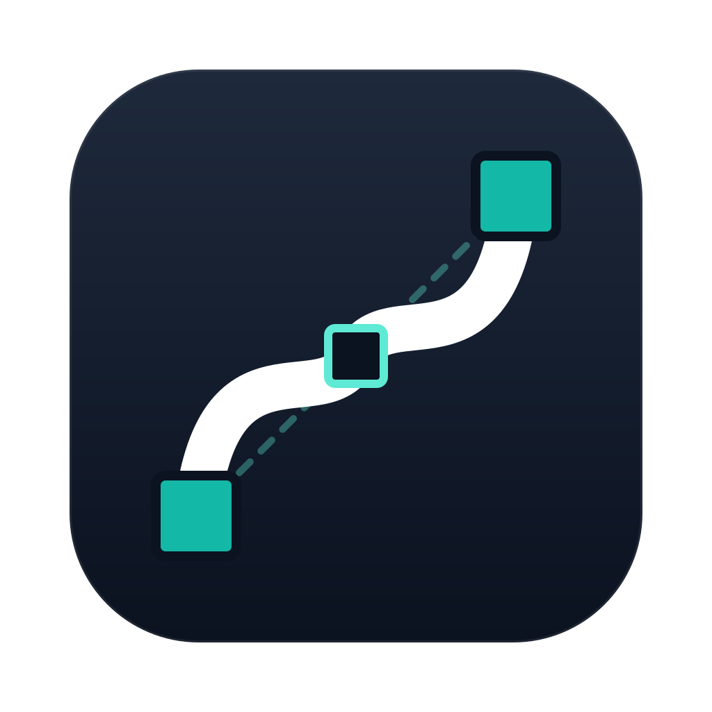
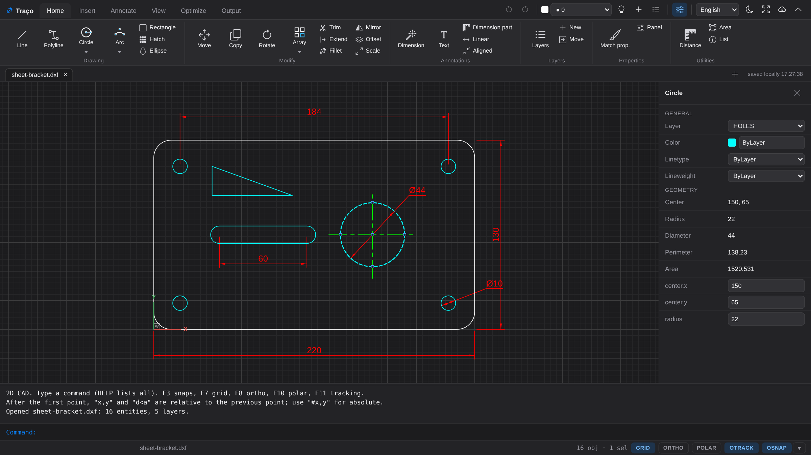
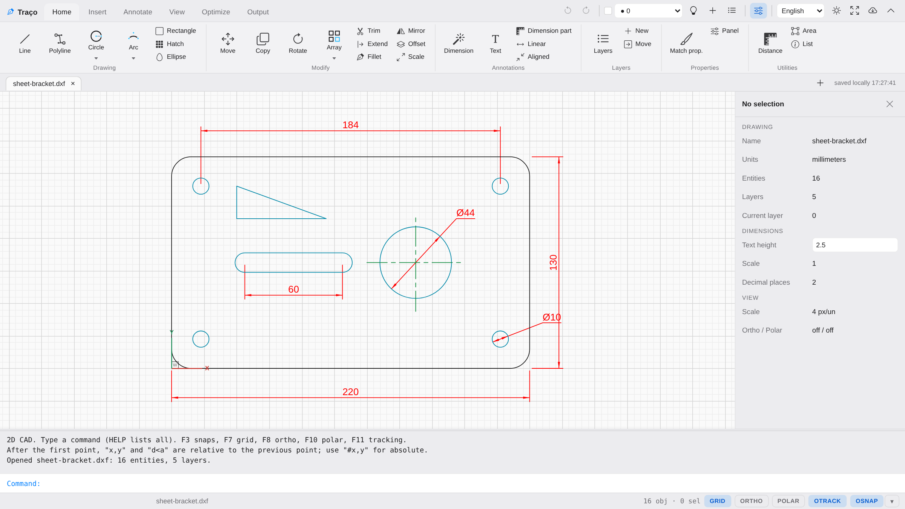

<p align="center"></p>

<h1 align="center">Traço CAD</h1>

A lightweight 2D CAD for technical drawing and DWG/DXF interchange, written in plain
JavaScript and HTML5 Canvas and shipped as a native desktop app with [Tauri](https://tauri.app)
for Windows, macOS and Linux.

Built and used in production by **[Triângulo Laser](https://trls.com.br)**, a laser cutting and
sheet-metal bending shop in Araguari, Brazil. It is the CAD our team uses every day to prepare
the drawings that go to the machines.



## Features

- **2D drafting**: line, polyline, circle and arc (including 2- and 3-point, tangent and the
  start/center/end variants), rectangle, ellipse, spline, hatch, text and blocks.
- **Editing**: move, copy, rotate, mirror, scale, offset, trim and extend, fillet and chamfer,
  array, explode, stretch, lengthen, divide and measure, polyline editing, with grips and
  per-entity properties.
- **Precision**: object snaps (endpoint, midpoint, center, quadrant, intersection,
  perpendicular, tangent, nearest), ortho mode, polar tracking, dynamic input and a command line
  with the usual commands and aliases.
- **Dimensions**: linear, aligned, angular, radius, diameter, baseline and continue, with
  per-layer style and scale.
- **Layers**: color, linetype and lineweight, hide and lock.
- **Files**: opens and saves **DXF** and **DWG** natively (no external converter), imports
  **SVG**, vector **PDF**, **CorelDRAW (CDR)** and **QElectroTech** projects and elements, and
  prints.
- **Desktop app**: tabs, recovery of open work, file associations and signed automatic updates.

Traço is CAD only: no nesting, CAM or machine post-processing.

The interface is available in English, Spanish and Portuguese, following the system language
or the selector next to the theme button. Commands use their usual English names (`LINE`,
`CIRCLE`, `TRIM`, `OFFSET`…), and Portuguese aliases also work.



The drawing in the screenshots is [`examples/sheet-bracket.dxf`](examples/sheet-bracket.dxf).

## Download

Official installers for Windows, macOS (Apple Silicon and Intel) and Linux:
**[trls.com.br/traco](https://trls.com.br/traco)**. Installed copies update themselves.

## Build from source

Requires Node.js 20+ and, for the desktop app, [Rust and the Tauri prerequisites](https://tauri.app/start/prerequisites/).

```bash
npm ci
npm test              # engine tests (node --test)
npm run dev           # web version at http://localhost:5173
npm run tauri dev     # desktop app in development mode
npm run tauri build   # installer for the current OS
```

Builds made from source check for updates at the same address as the official installers. To
produce signed update packages of your own, use your own `tauri signer` key and turn on
`createUpdaterArtifacts` in `src-tauri/tauri.conf.json`.

## Layout

| Path | Contents |
|---|---|
| `src/cad/` | Engine: document, geometry, commands, snaps, rendering and file formats |
| `src/cad.js` | Interface: ribbon, panels, tabs and properties |
| `src/main.js`, `src/updater.js` | Desktop bridge and automatic updates |
| `src-tauri/` | Native app (Rust/Tauri) |
| `tests/` | Engine and interface tests |
| `AGENTS.md` | Rules for contributors and coding agents |
| `glossary.md` | Project glossary |

## License

© 2026 Triângulo Laser Corte e Dobra Ltda. Open source under the **[GNU AGPL-3.0](LICENSE)**.
To use Traço in closed-source products, embedded in equipment, or offered as a service without
publishing your changes, contact us about a commercial license:
[contato@trls.com.br](mailto:contato@trls.com.br).

Contributions are welcome under the [Contributor License Agreement](CLA.md), which keeps dual
licensing possible. Read [AGENTS.md](AGENTS.md) before changing the code.

---

*Em português*: o Traço é um CAD 2D leve, de código aberto, desenvolvido e usado pela
Triângulo Laser, com interface em português, inglês e espanhol. Instaladores em
[trls.com.br/traco](https://trls.com.br/traco).
